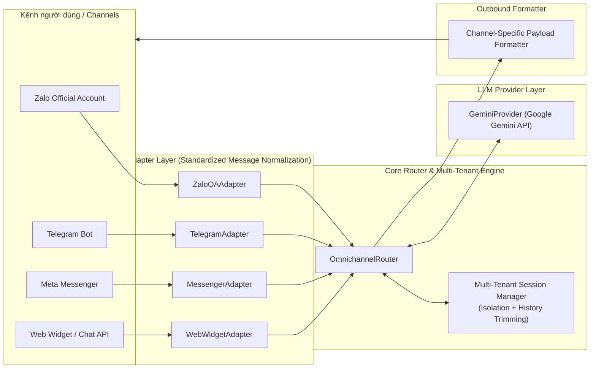

# Omnichannel AI Gateway 🌐🤖

[](https://bun.sh)
[](https://www.typescriptlang.org)
[](https://opensource.org/licenses/MIT)

> **Multi-Tenant Omnichannel AI Agent SDK (Google Gemini + Zalo Official Account, Telegram, Meta Messenger & Web Widget)**  
> *Giải pháp Gateway AI thông minh đa kênh chuẩn doanh nghiệp, hỗ trợ cô lập phiên đa người thuê (Multi-tenant) và kiến trúc Adapter module hóa linh hoạt.*

---

## 📖 Overview / Giới thiệu tổng quan

**Omnichannel AI Gateway** is an enterprise-grade AI routing and integration SDK designed for conversational agents. It connects modern generative AI models (such as Google Gemini 1.5 Pro / Flash) with major messaging channels across Vietnam and international markets, including **Zalo OA**, **Telegram**, **Facebook Messenger**, and **Web Widget/Chatbot**.

**Omnichannel AI Gateway** là bộ SDK định tuyến AI đa kênh cấp doanh nghiệp, kết nối các mô hình AI tạo sinh (Google Gemini) với các kênh nhắn tin phổ biến tại Việt Nam và quốc tế: **Zalo OA**, **Telegram**, **Meta Messenger**, và **Web Chat Widget**. Hệ thống đảm bảo cô lập hoàn toàn phiên hội thoại đa doanh nghiệp (Multi-Tenant Session Isolation), tự động rút gọn ngữ cảnh (Sliding Context Window Trimming), và chuẩn hóa dữ liệu tin nhắn hai chiều.

---

## 🏗 Architecture / Kiến trúc hệ thống



---

## ✨ Key Features / Tính năng nổi bật

- 🏢 **Multi-Tenant Session Isolation**: Mỗi công ty / doanh nghiệp khách hàng (`tenantId`) sở hữu không gian lưu trữ ngữ cảnh hội thoại độc lập, loại bỏ rủi ro rò rỉ dữ liệu chéo giữa các bên.
- 🔄 **Pluggable Channel Adapters**: Cung cấp sẵn các adapter cho Zalo OA, Telegram, Meta Messenger, Web Chat Widget. Dễ dàng mở rộng thêm các kênh như WhatsApp, Viber, Slack bằng cách cài đặt `BaseAdapter`.
- 🧠 **Context & History Trimming**: Tự động giới hạn và cắt gọt số lượt hội thoại (`maxHistoryTurns`) để tối ưu hóa chi phí token và tốc độ phản hồi của mô hình LLM.
- ⚡ **Lightweight & Blazing Fast**: Được xây dựng nguyên bản cho [Bun](https://bun.sh) và TypeScript, tối thiểu hóa độ trễ webhook và xử lý đồng thời lượng tin nhắn lớn.
- 🧪 **Mock-Ready for Testing**: Hỗ trợ `mockResponder` trong `GeminiProvider` giúp viết Unit Test / Integration Test dễ dàng mà không tốn quota API.

---

## 🚀 Quickstart / Hướng dẫn sử dụng nhanh

### 1. Installation / Cài đặt

```bash
# Cài đặt qua Bun
bun install omnichannel-ai-gateway
```

### 2. Basic Setup / Khởi tạo cơ bản

```typescript
import {
  OmnichannelRouter,
  ZaloOAAdapter,
  TelegramAdapter,
  MessengerAdapter,
  WebWidgetAdapter,
  GeminiProvider,
} from "omnichannel-ai-gateway";

// 1. Khởi tạo LLM Provider
const llmProvider = new GeminiProvider({
  apiKey: process.env.GEMINI_API_KEY || "your-gemini-api-key",
  modelName: "gemini-1.5-flash",
  systemPrompt: "Bạn là trợ lý AI thông minh tư vấn tuyển dụng và dịch vụ chuyên nghiệp.",
});

// 2. Khởi tạo Router với cấu hình Multi-tenant
const router = new OmnichannelRouter({
  llmProvider,
  maxHistoryTurns: 10,
});

// 3. Đăng ký các Channel Adapters
router.registerAdapter(new ZaloOAAdapter());
router.registerAdapter(new TelegramAdapter());
router.registerAdapter(new MessengerAdapter());
router.registerAdapter(new WebWidgetAdapter());

// 4. Xử lý Webhook đến từ kênh bất kỳ
export async function handleChannelWebhook(channel: string, rawPayload: any, tenantId: string) {
  const reply = await router.handleWebhook(channel, rawPayload, tenantId);
  
  if (reply) {
    console.log(`Gửi phản hồi tới ${reply.recipientId}:`, reply.text);
    // Gửi reply.rawPayload trở lại API của nền tảng (Zalo, Telegram, Meta,...)
    return reply.rawPayload;
  }
}
```

---

## 🛠 API Reference / Tài liệu API

### `OmnichannelRouter`

Class quản lý vòng đời xử lý tin nhắn, định tuyến adapter, và quản lý phiên hội thoại.

| Method | Tham số | Mô tả |
| :--- | :--- | :--- |
| `registerAdapter(adapter)` | `BaseAdapter` | Đăng ký một kênh liên lạc mới vào hệ thống. |
| `handleWebhook(channel, payload, tenantId)` | `string, any, string` | Phân tích webhook payload, tìm phiên tenant, gọi LLM và trả về phản hồi định dạng chuẩn theo kênh. |
| `getSession(tenantId, userId)` | `string, string` | Lấy phiên hội thoại hiện tại của người dùng thuộc tenant tương ứng. |
| `clearSession(tenantId, userId)` | `string, string` | Xóa ngữ cảnh trò chuyện của người dùng. |

### `BaseAdapter` & Custom Adapters

Để tích hợp thêm một kênh giao tiếp mới (ví dụ: Slack hoặc WhatsApp):

```typescript
import { BaseAdapter, NormalizedMessage, ChannelResponse } from "omnichannel-ai-gateway";

export class SlackAdapter extends BaseAdapter {
  readonly channelName = "slack";

  parseWebhook(payload: any): NormalizedMessage | null {
    if (!payload.event || payload.event.type !== "message") return null;
    return {
      channel: this.channelName,
      senderId: payload.event.user,
      text: payload.event.text,
      metadata: { ts: payload.event.ts, channelId: payload.event.channel },
    };
  }

  formatResponse(recipientId: string, text: string, metadata?: any): ChannelResponse {
    return {
      recipientId,
      text,
      rawPayload: {
        channel: metadata?.channelId || recipientId,
        text,
      },
    };
  }
}
```

---

## 🧪 Running Tests / Kiểm thử

Bộ kiểm thử được viết bằng test runner tích hợp của Bun:

```bash
# Chạy toàn bộ test suites
bun test

# Chạy riêng gateway tests
bun test tests/gateway.test.ts
```

---

## 📄 License

Dự án phát hành theo giấy phép [MIT License](LICENSE).
